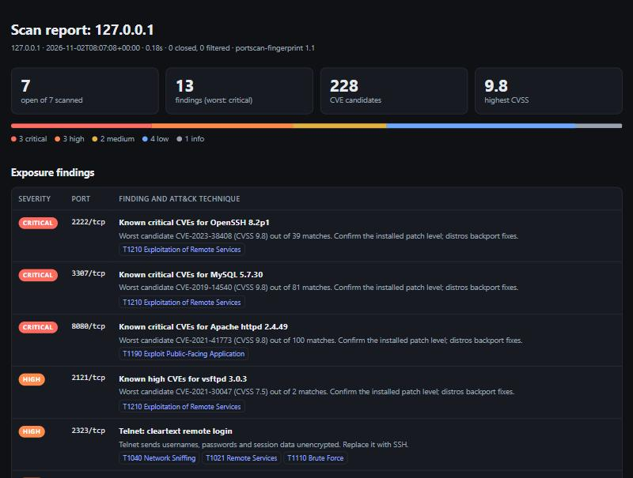

<div align="center">

# portscan-fingerprint

**Asset discovery and exposure assessment. Scans a host, identifies the software behind every open port, and tells you what an attacker could do with it.**

[](https://github.com/BlazeXYZ/portscan-fingerprint/actions/workflows/tests.yml)




<sub>Report from a scan of the bundled lab. The full file is <a href="docs/sample-report.html"><code>docs/sample-report.html</code></a>; download it and open it in a browser.</sub>

</div>

---

## Table of contents

1. [The problem](#the-problem)
2. [What portscan-fingerprint does](#what-portscan-fingerprint-does)
3. [Quick start](#quick-start)
4. [Demo: a scan of the bundled lab](#demo-a-scan-of-the-bundled-lab)
5. [Specification](#specification)
6. [Findings and MITRE ATT&CK mapping](#findings-and-mitre-attck-mapping)
7. [Architecture](#architecture)
8. [Output formats](#output-formats)
9. [Key design decisions](#key-design-decisions)
10. [Security of the tool itself](#security-of-the-tool-itself)
11. [Testing and CI](#testing-and-ci)
12. [Limitations and roadmap](#limitations-and-roadmap)
13. [Legal and ethical use](#legal-and-ethical-use)

---

## The problem

You cannot defend what you do not know is exposed. A host can run a forgotten Telnet service, an old web server or a database reachable from the network, and an attacker needs only a port scan to find it. An open port number says little on its own. The useful questions are *what software is listening, which version, and what could be done to it?*

Answering them by hand means grabbing a banner from each port, reading TLS certificates, looking up every version in a vulnerability database and translating the results into risk. Existing tools do this well, but they hide the mechanics behind large dependencies.

**portscan-fingerprint** does the whole chain with the Python standard library, so the mechanics stay readable.

## What portscan-fingerprint does

A Python tool for asset discovery and exposure assessment. It scans a host's TCP ports, identifies the software behind each open port, and reads TLS certificates. It reports what an attacker could do with each finding, mapped to **MITRE ATT&CK**, and matches software versions to known CVEs in the **NIST National Vulnerability Database** by CPE name. Output is a terminal report, JSON, and a self-contained HTML report.

It uses only the Python standard library. That includes the asynchronous scanner, the binary protocol parsers and the X.509 certificate parser.

| Capability | Detail |
|---|---|
| Concurrent scanning | `asyncio` TCP connect scan with a bounded semaphore. It classifies each port as open, closed or filtered. |
| Service fingerprinting | An ordered regex signature table, plus binary parsers for the MySQL/MariaDB handshake and Telnet option negotiation. |
| TLS inspection | Detects TLS on any port. Records the negotiated protocol and parses the certificate's subject, issuer, SANs, expiry and self-signed status. |
| CVE matching | Looks up versions by **CPE 2.3 name**, so the NVD evaluates affected-version ranges. Falls back to keyword search. Results are ranked by CVSS, rate-limited and cached. |
| Exposure findings | 14 rules, ranked CRITICAL to INFO. Each is tagged with the ATT&CK technique an attacker would use. |
| Reporting | Terminal, JSON, and offline HTML. All untrusted output is escaped. |
| Safety | Refuses non-private targets without explicit confirmation. Uses connect scans only, with no raw packets. |
| Tests | 28 tests, with no network access needed. CI runs on Linux, Windows and macOS. |

## Quick start

Requires Python 3.10 or later. Nothing to install. The HTTPS lab service also needs the `openssl` command line tool, which ships with Git for Windows, macOS and most Linux distributions.

```bash
git clone https://github.com/BlazeXYZ/portscan-fingerprint.git
cd portscan-fingerprint

# Terminal 1: start the local lab (fake SSH, HTTP, HTTPS, FTP, SMTP, MySQL and Telnet services on 127.0.0.1)
python lab.py

# Terminal 2: scan it
python portscan.py 127.0.0.1 -p 2121,2222,2323,2525,3307,8080,8443

# Add CVE lookup and write JSON and HTML reports
python portscan.py 127.0.0.1 -p 2121,2222,2323,2525,3307,8080,8443 --cve --json scan-lab.json --html report.html

# Rebuild the HTML report from saved JSON, with no rescan
python report.py scan-lab.json -o report.html
```

Run the tests:

```bash
pip install -r requirements.txt   # just pytest
python -m pytest
```

### Usage and options

```
python portscan.py TARGET [-p PORTS] [-t SECONDS] [-c N] [--cve] [--cve-mode {cpe,keyword}]
                          [--json FILE] [--html FILE] [--i-own-this]
```

| Flag | Default | Meaning |
|---|---|---|
| `TARGET` | | A single hostname or IP address. |
| `-p, --ports` | 43 common ports | A list and/or ranges: `22,80,443`, `1-1024`, `20-25,8080`. |
| `-t, --timeout` | `1.0` | Per-connection timeout in seconds, between 0 and 30. |
| `-c, --concurrency` | `200` | Number of simultaneous connections, capped at 500. |
| `--cve` | off | Look up CVE candidates in the NVD. Set `NVD_API_KEY` to raise the rate limit. |
| `--cve-mode` | `cpe` | `cpe`: exact product and version, with keyword fallback. `keyword`: text search only. |
| `--json FILE` | | Write machine-readable results. |
| `--html FILE` | | Write a self-contained HTML report. |
| `--i-own-this` | | Confirm you are authorized to scan a non-private address. |
| `--version` | | Print the version. |

Exit codes: `0` on success, `2` on bad input or a refused target.

## Demo: a scan of the bundled lab

<p align="center"></p>
<p align="center"><sub>Recorded with <a href="https://github.com/BlazeXYZ/termreel">termreel</a> from <a href="docs/demo.reel"><code>docs/demo.reel</code></a>.</sub></p>

Scanning the local lab with `--cve`. The lab serves banners only. Its versions are deliberately old so that CVE lookup returns results.

```
Scan report for 127.0.0.1 (127.0.0.1)

PORT      SERVICE  PRODUCT / VERSION       BANNER
2121/tcp  ftp      vsftpd 3.0.3            220 (vsFTPd 3.0.3)
2222/tcp  ssh      OpenSSH 8.2p1           SSH-2.0-OpenSSH_8.2p1 Ubuntu-4ubuntu0.5
2323/tcp  telnet   -                       lab login:
2525/tcp  smtp     Postfix                 220 mail.lab ESMTP Postfix (Ubuntu)
3307/tcp  mysql    MySQL 5.7.30            5.7.30-0ubuntu0.18.04.1 abcdefgh
8080/tcp  http     Apache httpd 2.4.49     HTTP/1.1 200 OK
8443/tcp  https    nginx 1.18.0 [TLSv1.3]  HTTP/1.1 200 OK

7 open, 0 closed, 0 filtered of 7 ports in 0.18s

TLS certificates
  8443/tcp  CN=lab.local  issuer=lab.local  expires 2026-11-22 (19d)  [self-signed]
            SANs: lab.local, localhost, 127.0.0.1

Exposure findings (MITRE ATT&CK technique an attacker would use)
  CRITICAL  2222/tcp  Known critical CVEs for OpenSSH 8.2p1  [T1210]
  CRITICAL  3307/tcp  Known critical CVEs for MySQL 5.7.30  [T1210]
  CRITICAL  8080/tcp  Known critical CVEs for Apache httpd 2.4.49  [T1190]
  HIGH      2121/tcp  Known high CVEs for vsftpd 3.0.3  [T1210]
  HIGH      2323/tcp  Telnet: cleartext remote login  [T1040, T1021, T1110]
  HIGH      8443/tcp  Known high CVEs for nginx 1.18.0  [T1190]
  MEDIUM    2121/tcp  FTP without TLS  [T1040, T1110]
  MEDIUM    3307/tcp  Database reachable over the network (mysql)  [T1110, T1210]
  LOW       8080/tcp  Web server discloses its version  [T1592.002]
  LOW       8443/tcp  Web server discloses its version  [T1592.002]
  LOW       8443/tcp  TLS certificate expires soon  [-]
  LOW       8443/tcp  Self-signed TLS certificate  [T1557]
  INFO      2222/tcp  SSH remote login exposed  [T1021.004, T1110]

CVE candidates (verify the installed patch level before acting)
  8080/tcp Apache httpd 2.4.49  (CPE match)
    CVE-2021-41773   9.8 CRITICAL  A flaw was found in a change made to path normalization in Apache HTTP
    CVE-2021-42013   9.8 CRITICAL  It was found that the fix for CVE-2021-41773 in Apache HTTP Server 2.4
    ...
    (100 total matches; distro backports are not considered)
```

## Specification

### Port states

| State | Meaning | How it is detected |
|---|---|---|
| open | A service accepted the connection | The TCP handshake completed |
| closed | The host is up, but nothing listens on the port | The host answered with RST (`ConnectionRefusedError`) |
| filtered | Packets were dropped, usually by a firewall | Timeout, or another `OSError` such as an unreachable host |

### Banner grabbing

| Parameter | Value | Why |
|---|---|---|
| First read wait | `min(timeout, 1.0)` s | Greetings arrive within milliseconds. A long wait on every quiet port would slow wide scans. |
| Follow-up reads | 0.15 s each | Collect a banner split across TCP segments without waiting long. |
| Max banner size | 2048 bytes | Enough for HTTP headers and a handshake, while capping memory per connection. |
| HTTP probe | `HEAD / HTTP/1.0`, `Connection: close` | `HEAD` asks for headers only, with no body. HTTP/1.0 with close makes the server end the connection, so reading stops on EOF. |
| Display summary | First line, 80 characters | If under 70% of the bytes are printable, the banner is treated as binary and only printable runs of 4 or more characters are shown. |

### Fingerprint signatures

Signatures are checked in order, most specific first, and the first match wins. Two binary parsers run before the regex table:

- **MySQL/MariaDB handshake.** A 3-byte little-endian length, 1 sequence byte, protocol version `0x0a`, then a NUL-terminated server version. MariaDB prefixes its version with `5.5.5-` for old replication clients. The parser strips that prefix and reports MariaDB.
- **Telnet.** The first byte is `IAC` (255), followed by `WILL`/`WONT`/`DO`/`DONT` (251–254), as in RFC 854 option negotiation.

The regex table covers OpenSSH, Dropbear, generic SSH, ProFTPD, vsftpd, Pure-FTPd, generic FTP, Exim, Postfix, generic SMTP, Apache, nginx, IIS, any other `Server:` header, generic HTTP, Dovecot IMAP and Redis.

### TLS

- The client context accepts **any certificate**, and the **oldest protocol the local OpenSSL allows** (`TLSVersion.MINIMUM_SUPPORTED`, `ALL:@SECLEVEL=0`).
- The certificate is read with `getpeercert(binary_form=True)` and parsed by `certinfo.parse_cert`. It returns the subject CN, the issuer CN (or O), DNS and IP SANs, `not_before`, `not_after`, `days_left`, `expired` and `self_signed`.
- **TLS detection:** after a plaintext attempt, if the port sent nothing, or sent bytes starting `0x15 0x03` (a TLS *alert* record), the scanner retries with TLS. It keeps the TLS result only if the handshake succeeds.

### CVE lookup (NVD CVE API 2.0)

| Item | Value |
|---|---|
| Endpoint | `https://services.nvd.nist.gov/rest/json/cves/2.0` |
| CPE query | `cpeName=cpe:2.3:a:<vendor>:<product>:<version>:<update>:*:*:*:*:*:*`, `resultsPerPage=200` |
| Keyword query | `keywordSearch=<product> <version>`, `resultsPerPage=20`. A `pN` suffix is removed, so `8.2p1` becomes `8.2`. |
| Version split | `8.2p1` becomes version `8.2`, update `p1`. `1.3.5e` becomes `1.3.5`, update `e`. |
| Fallback | Keyword search if the product has no CPE mapping, or if the NVD rejects the CPE name with HTTP 404. |
| Score used | CVSS v3.1 base score, else v3.0, else v2 |
| Severity bands | 9.0+ CRITICAL · 7.0–8.9 HIGH · 4.0–6.9 MEDIUM · 0.1–3.9 LOW · 0 NONE · missing UNKNOWN |
| Ranking | Score descending, unscored last, then CVE ID. The top 10 are cached and the top 5 shown. |
| Rate limit | At least 6.5 s between requests without a key, 0.7 s with `NVD_API_KEY`. The NVD's published limits are 5 or 50 requests per 30 s. |
| Cache | `.nvd_cache.json`, keyed by query string, with a 24-hour time-to-live |
| Errors | 403/429 report "rate limited". Network errors report the reason. Neither stops the scan. |

CPE mappings (`nvd.CPE_PRODUCTS`), each checked against the live API:

| Fingerprint product | CPE vendor:product |
|---|---|
| OpenSSH | `openbsd:openssh` |
| Dropbear | `dropbear_ssh_project:dropbear_ssh` |
| vsftpd | `vsftpd_project:vsftpd` |
| ProFTPD | `proftpd:proftpd` |
| Exim | `exim:exim` |
| Apache httpd | `apache:http_server` |
| nginx | `f5:nginx` (`nginx:nginx` returns 0 results) |
| Microsoft IIS | `microsoft:internet_information_services` |
| MySQL | `oracle:mysql` |
| MariaDB | `mariadb:mariadb` |
| Redis | `redis:redis` |

## Findings and MITRE ATT&CK mapping

Each rule is tagged with the ATT&CK technique an attacker would use against the finding.

| Severity | Rule | ATT&CK |
|---|---|---|
| CRITICAL | Docker API port 2375 open (identified by port number only) | T1610, T1190 |
| CRITICAL / HIGH | Worst CVE candidate scores ≥ 9.0 / ≥ 7.0 | T1190 (web) or T1210 (other) |
| HIGH | Telnet: cleartext remote login | T1040, T1021, T1110 |
| HIGH | SMB/NetBIOS exposed | T1021.002, T1210 |
| HIGH | Redis answers `PING` without authentication | T1210 |
| MEDIUM | FTP without TLS | T1040, T1110 |
| MEDIUM | RDP / VNC / WinRM exposed | T1021.001 / .005 / .006, T1110 |
| MEDIUM | Database reachable over the network | T1110, T1210 |
| MEDIUM | Deprecated protocol negotiated (SSLv3, TLS 1.0, 1.1) | T1557 |
| MEDIUM | TLS certificate expired | T1557 |
| LOW | Web server discloses its version | T1592.002 |
| LOW | TLS certificate expires within 30 days | none |
| LOW | Self-signed TLS certificate | T1557 |
| INFO | SSH remote login exposed | T1021.004, T1110 |

## Architecture

```mermaid
flowchart LR
    A[CLI args] --> B{Authorization guard<br/>private / loopback?}
    B -- no, and no --i-own-this --> X[exit 2]
    B -- yes --> C[Async connect scan<br/>open / closed / filtered]
    C -- open --> D[Banner grab<br/>listen, then probe]
    D -- silent or TLS alert --> D2[Retry with TLS<br/>read certificate]
    D --> E[Fingerprint<br/>signatures + binary parsers]
    D2 --> E
    E --> F[(PortResult)]
    F -- --cve --> G[NVD lookup<br/>CPE name, keyword fallback<br/>rate limit + cache]
    G --> F
    F --> H[Findings engine<br/>rules + ATT&CK mapping]
    H --> I[Terminal report]
    H --> J[JSON]
    J --> K[HTML report]
```

1. **Authorize.** The target is resolved and checked with `ipaddress`. Private, loopback and link-local addresses are allowed. Anything else needs `--i-own-this`.
2. **Probe state.** For each port, under a semaphore, `asyncio.open_connection` attempts a full TCP handshake:
   - A completed handshake means **open**.
   - `ConnectionRefusedError` (the host replied with RST) means **closed**.
   - A timeout or any other `OSError` means **filtered**, because something dropped the packets.
3. **Grab a banner** on a fresh connection to each open port:
   - On HTTP ports, send `HEAD / HTTP/1.0` right away.
   - Otherwise, listen first, because SSH, FTP, SMTP, MySQL and Telnet send a greeting.
   - If nothing arrives, send a probe: Redis gets `PING`, and anything else gets the HTTP request.
4. **Detect TLS.** If a non-TLS port stayed silent, or answered with a TLS alert record, reconnect with a TLS handshake. Record the negotiated version and the certificate as raw DER bytes.
5. **Fingerprint** the bytes into `(service, product, version)`.
6. **Look up CVEs** (optional) for each service with a product and version.
7. **Assess.** Run the findings rules on each port, after the CVE lookup because CVE severity feeds the findings.
8. **Report** in the terminal, then optionally as JSON and HTML. The HTML is rendered from the JSON dictionary.

### Project layout

```
portscan-fingerprint/
├── portscan.py        CLI, authorization guard, async scanner, banner grabbing, terminal and JSON output
├── fingerprint.py     Banner bytes -> (service, product, version). Pure functions.
├── certinfo.py        Minimal DER/X.509 reader for unverified certificates. Pure functions.
├── nvd.py             NVD CVE API 2.0 client: CPE/keyword lookup, CVSS ranking, rate limit, cache
├── findings.py        Exposure rules and the MITRE ATT&CK technique table. Pure functions.
├── report.py          JSON -> self-contained HTML report (also a standalone CLI)
├── lab.py             Local fake services for demos and end-to-end tests
├── tests/
│   └── test_portscan.py
├── docs/
│   ├── report.jpg           screenshot used above
│   ├── sample-report.html   HTML report from a lab scan
│   └── sample-scan.json     the JSON it was rendered from
├── .github/workflows/tests.yml   CI: Linux (3.10–3.14), Windows, macOS
├── pyproject.toml     pytest configuration
├── requirements.txt   dev dependency (pytest) only
├── CHANGELOG.md
└── LICENSE
```

The split follows one rule: **everything that touches the network is kept apart from everything that interprets data.**
- `fingerprint.py`, `certinfo.py`, `findings.py` and most of `nvd.py` are pure functions, so you can test them with byte strings and dictionaries.
- `portscan.py` and the HTTP part of `nvd.py` do the input/output.

## Output formats

| Flag | Output |
|---|---|
| *(default)* | Terminal report: port table, TLS certificates, exposure findings, CVE candidates |
| `--json FILE` | Machine-readable results (abridged schema below) |
| `--html FILE` | Self-contained HTML report: no JavaScript, no external resources. See [`docs/sample-report.html`](docs/sample-report.html) |

Exit codes: **0** success, **2** bad input or a refused target. `python report.py scan.json -o report.html` rebuilds the HTML from saved JSON without rescanning.

### JSON schema (abridged)

```jsonc
{
  "tool": "portscan-fingerprint 1.1",
  "target": "127.0.0.1", "address": "127.0.0.1",
  "scanned_at": "2026-11-02T08:07:08+00:00",
  "ports_scanned": 7, "duration_seconds": 0.18,
  "closed": 0, "filtered": 0,
  "open": [{
    "port": 8443, "state": "open", "service": "https",
    "product": "nginx", "version": "1.18.0", "banner": "HTTP/1.1 200 OK",
    "tls": "TLSv1.3",
    "cert": { "subject": "lab.local", "issuer": "lab.local", "sans": ["lab.local"],
              "not_before": "...", "not_after": "...", "days_left": 19,
              "expired": false, "self_signed": true },
    "cves": [{ "id": "CVE-2021-23017", "score": 7.7, "severity": "HIGH", "summary": "..." }],
    "cve_total": 6, "cve_method": "cpe", "cve_error": null,
    "findings": [{ "severity": "LOW", "title": "...", "detail": "...",
                   "attack": [{ "id": "T1557", "name": "Adversary-in-the-Middle", "url": "..." }] }]
  }],
  "severity_counts": { "CRITICAL": 3, "HIGH": 3, "MEDIUM": 2, "LOW": 4, "INFO": 1 },
  "attack_techniques": [{ "id": "T1021", "name": "Remote Services", "url": "..." }]
}
```

## Key design decisions

Each section gives the choice, the alternatives and the reasoning.

### 1. Standard library only, not Scapy, `requests`, `cryptography` or an Nmap wrapper

- **Chosen:** `asyncio`, `socket`, `ssl`, `urllib`, `ipaddress`, `json`, `html`.
- **Alternatives:**
  - Scapy for packet crafting.
  - `python-nmap` to drive Nmap.
  - `requests` for HTTP.
  - `cryptography` for certificates.
- **Why:**
  - The project is meant to show the mechanics. Wrapping Nmap would show how to call Nmap, not how service detection works.
  - With zero dependencies, `git clone` then `python portscan.py` works on any machine with Python 3.10+, including a locked-down lab VM.
  - There is no supply-chain surface: a security tool that pulls in dozens of packages is a poor example.
- **Cost:** two things had to be written by hand that libraries would provide. One is the X.509 parser (decision 8). The other is HTTP retry and pooling, which this tool doesn't need.

### 2. `asyncio`, not threads or processes

- **Chosen:** one event loop, with an `asyncio.Semaphore` capping concurrency.
- **Alternatives:**
  - `ThreadPoolExecutor` with blocking sockets.
  - `multiprocessing`.
- **Why:**
  - A port scan is almost entirely waiting on the network, so it is I/O-bound.
  - Coroutines cost kilobytes each, while threads cost a stack each and add context switches. Hundreds of in-flight connections are cheap with `asyncio`.
  - `asyncio.wait_for` makes per-connection timeouts one line.
  - Processes would add serialization overhead for no CPU gain.
- **Why a semaphore and a cap of 500:**
  - Each connection uses a file descriptor. macOS defaults to 256 open files per process, and a flood of connections can trip IDS rate alarms or overwhelm small devices.
  - The default of 200 is well under common limits.
  - `gather` keeps the results in port order. They are sorted anyway.

### 3. TCP connect scan, not a SYN ("half-open") scan

- **Chosen:** a full three-way handshake through the operating system's socket API.
- **Alternative:** a SYN scan, which crafts raw SYN packets, reads the SYN/ACK or RST, and never completes the handshake. This is Nmap's default when it runs as root.
- **Why:**
  - SYN scanning needs raw sockets, which means root or admin rights. On Windows, raw TCP sends have been blocked since XP SP2, so it would need a driver such as Npcap.
  - Connect scans run unprivileged everywhere and are easy to test against `127.0.0.1`.
  - Banner grabbing needs a full connection anyway.
- **Cost:** connect scans are noisier. The target application sees and may log each connection. They are also slower at very large scale. For an authorized assessment of your own host, being visible is fine, and arguably correct.

### 4. Separate connections for the state check and the banner

- **Chosen:** `probe_state` opens and closes a connection, then `grab_banner` opens a fresh one for each open port. A third connection is made only for the TLS retry.
- **Alternative:** keep the first connection open and read the banner from it.
- **Why:**
  - It keeps state classification and service interaction independent. Each is simple and testable, and `probe_state` never has to send anything.
  - It costs one extra connection per *open* port only. Closed and filtered ports, usually the vast majority, cost exactly one attempt.
- **Honest trade-off:** reusing the connection would be slightly faster and quieter. It is a reasonable optimization if wide scans ever matter. See the [roadmap](#limitations-and-roadmap).

### 5. Listen first, then probe

- **Chosen:** on non-HTTP ports, read for up to 1 s before sending anything. If the service is quiet, send one probe chosen by port.
- **Alternative:** send a fixed probe to every port, or run a library of probes like Nmap's `nmap-service-probes`.
- **Why:**
  - Many protocols are *server-speaks-first* (SSH, FTP, SMTP, MySQL, Telnet). Sending HTTP to an SSH server first can make some daemons log an error or close the connection before sending their greeting.
  - Listening first gets the cleanest banner.
  - For quiet services, HTTP is the best single guess: most unidentified listeners on odd ports are web applications.
- **Cost:** one probe cannot identify every quiet protocol, such as SMB or RDP. Service-specific probes are on the roadmap.

### 6. Ordered regex signatures plus binary parsers, not a big signature database

- **Chosen:** 17 regexes, ordered from specific to generic. The first match wins. Named groups `v` (version) and `p` (product) extract fields.
- **Alternatives:** Nmap's probe database (thousands of entries), or machine-learning classification.
- **Why:**
  - Readability and auditability. Each signature is one line, and the test table shows exactly what it matches.
  - The fallbacks are deliberate. A generic `^SSH-` signature still reports "ssh" when the vendor is unknown. A generic `Server:` signature captures products such as gunicorn without a dedicated entry.
- **Why binary parsers for MySQL and Telnet:** their greetings are binary. A regex over text decoded as latin-1 would be fragile. Parsing the length-prefixed MySQL handshake by its documented layout is exact. It also handles MariaDB's `5.5.5-` compatibility prefix, a detail that naive scanners report as "MySQL 5.5.5".

### 7. A permissive TLS client

- **Chosen:** `CERT_NONE`, `check_hostname=False`, the minimum protocol version set to the lowest supported, and `SECLEVEL=0` ciphers.
- **Alternative:** the secure defaults from `ssl.create_default_context()`.
- **Why:**
  - A scanner's job is to **observe and report** weak TLS. A strict client would fail to connect to a server offering only TLS 1.0 or an expired certificate, and the report would show nothing exactly where it matters most.
  - Trust decisions are made afterwards, as findings, not during the handshake.
  - The code wraps these settings in `try` because some OpenSSL builds refuse them. Modern servers still work either way.
- **Limitation:** the negotiated version is the *best* version both sides support. A server that supports TLS 1.3 *and* 1.0 is reported as 1.3. Listing every supported protocol would take one handshake per version (roadmap).

### 8. A hand-written DER/X.509 parser, not `cryptography` or a private API

- **Problem:** Python's `ssl.getpeercert()` returns an **empty dict** when the certificate wasn't verified, and a scanner never verifies. You can still get the raw DER bytes with `getpeercert(binary_form=True)`.
- **Alternatives:**
  1. `cryptography.x509.load_der_x509_certificate`: correct and complete, but a large compiled dependency (decision 1).
  2. `ssl._ssl._test_decode_cert(path)`: a private CPython test helper. It needs a file on disk and can change or disappear without notice.
  3. Write the certificate to disk and shell out to `openssl x509`: needs the external binary, and is slow.
  4. **A minimal DER reader** (chosen): about 100 lines.
- **How it works:**
  - DER is tag-length-value (TLV). A length byte with the high bit set means "the next *n* bytes are the length". The parser rejects lengths over 4 bytes, and elements that run past the buffer.
  - It walks `Certificate → tbsCertificate`, skips the optional `[0]` version, then takes issuer, validity and subject by position, as RFC 5280 fixes the order.
  - It then scans the `[3]` extensions for subjectAltName (OID 2.5.29.17), reading `dNSName [2]` and `iPAddress [7]`.
  - Times are `UTCTime` (two-digit year) or `GeneralizedTime` (four-digit year).
- **Robustness:** any malformed input returns `None`, never an exception. Tests feed it truncated, empty and garbage bytes.
- **Self-signed check:** the parser treats a certificate as self-signed when the issuer and subject DN bytes are identical. Strictly, that means *self-issued*. Proving *self-signed* means checking the signature against the certificate's own public key. For an exposure report, identical DNs is the standard practical signal.

### 9. Detecting TLS on any port from the TLS alert record

- **Chosen:** the TLS retry happens when a port is silent, or when it answers our plaintext with bytes starting `0x15 0x03`.
- **Why:**
  - A TLS server that receives plaintext either closes the connection or sends an **alert record**: content type 21 (`0x15`), then a protocol version whose major byte is `3`.
  - Port numbers are only conventions. HTTPS on 8443, 9443 or a random dev port would otherwise be reported as "unknown".
  - The end-to-end test proves this: the lab's HTTPS service runs on a random port that is not in `TLS_PORTS`.
- **Cost:** silent non-TLS services cost one extra connection attempt.

### 10. CPE matching, not keyword search

This change made the biggest difference to result quality. The numbers below come from the live NVD API:

| Query | Results | Notes |
|---|---|---|
| `keywordSearch=OpenSSH 8.2` | 2 | One was a 2007 Cisco/SSHield CVE that only mentions "OpenSSH 3.0.2p1" |
| `cpeName=cpe:2.3:a:openbsd:openssh:8.2:p1:…` | 39 | Includes CVE-2023-38408 (9.8) and other range-matched CVEs that never name "8.2" in their text |
| Apache httpd 2.4.49 via CPE | 100 | The top result is CVE-2021-41773, the well-known path traversal and RCE in exactly this version |

- **Why keyword search is wrong:** it matches *text in the description*.
  - Most CVEs say "OpenSSH before 9.3p2", not "8.2", so keyword search **misses** real matches.
  - It also **adds** unrelated ones that happen to contain the words.
- **Why CPE works:** the NVD stores, for each CVE, *configurations*: CPE match criteria with version ranges such as `versionEndExcluding: 9.3p2`. Querying by `cpeName` makes the NVD evaluate those ranges.
- **Why a hand-made vendor table, not the NVD CPE dictionary API:**
  - Mapping "OpenSSH" to `openbsd:openssh` could be automated by searching `/cpes/2.0`. That would double the rate-limited API calls, and fuzzy matching can choose the wrong vendor.
  - Eleven checked entries cover every product the fingerprinter can identify. The nginx entry shows why checking matters: the NVD moved nginx to the `f5` vendor, and the obvious `nginx:nginx` returns zero results.
- **Fallback rules:**
  - Keyword search is used only if the product has no mapping, or the NVD returns **404 `Invalid cpeName`**. That response was confirmed live for malformed names.
  - A valid CPE with **zero** results is reported as zero, not retried as keywords. Zero is a real answer. Retrying would bring back the noise that CPE matching exists to remove.
- **Remaining false positives:** CPE matching is only as good as NVD's configuration data.
  - For example, `oracle:mysql 5.7.30` returns CVE-2019-14540, a jackson-databind bug. Oracle listed MySQL products as affected because they bundled the library.
  - Linux distributions backport fixes without changing the version string. "Ubuntu-4ubuntu0.5" OpenSSH 8.2p1 is patched against many of these.
  - So every result is labelled a **candidate**, never a verdict.

### 11. Ranking CVEs locally by CVSS

- **Chosen:** fetch a page (200 for CPE, 20 for keyword), then sort by CVSS score, descending.
- **Alternative:** use the NVD's order, which is by publication date.
- **Why:** an analyst triages by severity. Showing the five *newest* CVEs could hide a 9.8 from years ago.
- **Score preference:** v3.1, then v3.0, then v2. CVSS v3 is current. v2 remains only for old CVEs that were never rescored.
- **Limitation:** if a product had more than 200 CVEs, only the first page would be ranked. No mapped product version reaches that today. Apache 2.4.49 has 100.

### 12. Rate limiting with a lock and a monotonic clock, and a JSON file cache

- **Rate limit:** the NVD allows 5 requests per rolling 30 seconds without a key, or 50 with one.
  - The client enforces a **minimum interval** (6.5 s or 0.7 s) using `time.monotonic()`. Wall-clock time can jump when NTP adjusts it, and a monotonic clock cannot.
  - A **lock** around the timestamp keeps the client correct even if it is called from several threads later. It is cheap insurance.
- **Cache:**
  - A plain JSON file with a 24-hour time-to-live, keyed by the CPE name or keyword string.
  - **Why not SQLite or `requests-cache`:** the data is tiny (a few KB per product), and JSON is human-readable for debugging.
  - **Backward compatible:** keyword keys stay as plain strings, so caches from v1.0 still work.
  - A cache write failure, such as a read-only directory, is ignored. It must never break a scan.

### 13. Defensive parsing everywhere

- **Chosen:** NVD responses are read with `.get()` and type checks. Certificate and banner parsers return `None` or an empty result instead of raising.
- **Why:**
  - Both the scanned host and the API are outside our control, and a scanner runs against unusual data by definition.
  - A missing CVSS block should give "n/a", not a traceback that loses the whole scan.
  - Tests cover malformed NVD entries, garbage certificates and binary banners.

### 14. Findings as code rules mapped to ATT&CK

- **Chosen:** one `assess(port)` function of small, explicit rules, plus a technique table.
- **Alternatives:**
  - A YAML or JSON rule DSL.
  - Pulling the full ATT&CK STIX dataset.
- **Why:**
  - Fourteen rules are easier to read, review and test as Python than as a DSL, which would need its own parser and validation.
  - The technique table holds only the 13 IDs used, with names, and builds URLs from the ID: `T1021.004` becomes `/techniques/T1021/004/`.
- **Why ATT&CK:**
  - It gives defenders a shared vocabulary. "SSH exposed" becomes "watch for T1110 Brute Force and T1021.004 SSH lateral movement".
  - This connects an offensive-looking tool to detection engineering. The scan itself is T1046, Network Service Discovery, so the tool is also useful for testing whether your own monitoring notices it.
- **Severity reasoning:**
  - Telnet is HIGH: credentials in cleartext plus a remote shell.
  - Redis answering `PING` with no password is HIGH: anyone who can reach it can read and write data, and on misconfigured hosts it can lead to code execution.
  - Version disclosure is LOW: it only speeds up reconnaissance.
  - SSH is INFO: exposing it is normal, but it's still worth tracking.

### 15. A self-contained HTML report, built from JSON, with everything escaped

- **Chosen:** Python string building with `html.escape` on every value. Inline CSS. **No JavaScript.** One file.
- **Alternatives:**
  - Jinja2 templates.
  - A React or JS dashboard.
  - A PDF library.
- **Why:**
  - **Threat model:** banners come from the scanned host and are attacker-controlled. A host could reply with `Server: <script>…</script>`. Escaping every value prevents a scan report from becoming a stored-XSS payload against the analyst who opens it. A test proves it. Having no JavaScript at all shrinks the attack surface further.
  - **Offline and portable:** with no CDN fonts or scripts, the report opens on an air-gapped analysis machine and can be attached to a ticket.
  - **Built from JSON, not live objects:** `report.py file.json` re-renders old scans without rescanning, and the JSON is the one source of truth for both outputs.
  - **Jinja2** would be cleaner for a large template, but it would be the project's first runtime dependency (decision 1).
- **Accessibility and layout:**
  - It uses `prefers-color-scheme` for dark mode and has a phone-width layout.
  - Severity is shown as text in each pill as well as by color, so it doesn't depend on color vision.

### 16. A private-address authorization guard

- **Chosen:** resolve the target, then allow it only if `ipaddress` classifies it as private, loopback or link-local. Otherwise require `--i-own-this`.
- **Why:**
  - Unauthorized scanning can be illegal: the US CFAA, the UK Computer Misuse Act, and providers' terms of service.
  - A safe default prevents accidents such as a typo in an IP address.
  - The flag name makes the user state their authorization explicitly.
- **What it is not:** a security control against a determined user. Anyone can pass the flag or edit the code. It is a **safety rail**, like `rm` asking before deleting a write-protected file.

### 17. One host at a time

- **Chosen:** no CIDR ranges.
- **Why:** the project is about depth per host (fingerprints, TLS, CVEs, findings), not breadth. Range scanning adds host discovery, much larger scale, and a bigger risk of accidental misuse. Masscan and Nmap already do sweeps well.

### 18. Scripts, not a pip package

- **Chosen:** top-level modules you run with `python portscan.py`.
- **Alternative:** a `portscan_fingerprint/` package with console entry points.
- **Why:**
  - Installing modules called `report`, `lab` or `findings` into `site-packages` would pollute the global import namespace.
  - Fixing that means a package directory and relative imports, which is worth doing only once there is a reason to `pip install` this.
  - For a portfolio tool, clone-and-run with no install is the simplest experience.
- `pyproject.toml` holds only the pytest configuration.

## Security of the tool itself

- **The lab is not vulnerable.** It serves banners only. The versions are deliberately old so that CVE lookup returns results.
- **The lab's TLS key never touches the repo.** `lab.py` creates a throwaway self-signed certificate with `openssl` in a temporary directory at startup, loads it into memory, and deletes the files. The test suite contains only the **public** certificate, used as a parser fixture.
- **Banners and certificates are untrusted input.** Banners are reduced to printable ASCII, and certificate names have control characters replaced. That stops ANSI escape-sequence injection into your terminal. The HTML report escapes every value.
- **API keys** come from the `NVD_API_KEY` environment variable and are never written to disk or output.

## Testing and CI

28 tests run in about 3 seconds with **no network access**:

| Area | Approach |
|---|---|
| Fingerprints | A parametrized table of 17 banners, including MariaDB, Telnet, TLS garbage and empty input |
| Input handling | Port-spec parsing, including invalid ranges. The authorization guard is checked by calling `main()` against `8.8.8.8`. |
| NVD client | **Dependency injection:** `NVDClient(fetch=...)` takes a fake HTTP function. Tests cover ranking, missing fields, caching (one call for two lookups), CPE URL construction, 404 fallback, rate-limit and network errors. |
| Certificates | A fixed public certificate fixture, parsed with an injected `now`, so expiry tests never become flaky as real time passes. Truncated and garbage DER return `None`. |
| Findings | Each rule is exercised with lightweight `SimpleNamespace` port objects |
| Reports | An XSS banner is escaped; old or empty JSON still renders; the CLI writes valid JSON and HTML |
| End to end | Starts the lab on **ephemeral ports** (port 0), so tests never collide with real services. Scans it, checks every fingerprint, TLS detection on a random port, the certificate, the Telnet finding, and a closed port. |

**CI** ([`.github/workflows/tests.yml`](.github/workflows/tests.yml)) runs Python 3.10–3.14 on Ubuntu, and the newest Python on Windows and macOS. Socket behavior really does differ between operating systems:

- Windows retries a connection refused with RST for about 2 seconds before reporting it. That was found while developing this project and is documented under [Limitations and roadmap](#limitations-and-roadmap).
- If `openssl` is missing on a runner, the lab skips HTTPS and the test adapts instead of failing.

## Limitations and roadmap

**Known limitations**, written down on purpose:

- **One host, TCP only.** No CIDR ranges, UDP or OS detection.
- **The best TLS version only.** A server that also accepts TLS 1.0 is flagged only when 1.0 is the newest version it offers.
- **One probe for quiet services.** SMB, RDP and other binary protocols that wait for the client are named from the port number only.
- **CVE results are candidates.** Distro backports and vendor bundling (decision 10) cause false positives. Confirm against the installed package version.
- **Some findings are port-based.** For example, Docker on 2375. Their text says so.
- **Windows timing.** The Windows TCP stack retries a refused connection for about 2 s (measured 2.05 s on Windows 10). With `--timeout` below that, closed ports are reported as *filtered*. Use `-t 2.5` when the closed/filtered split matters.
- **No result paging.** CPE lookups rank only the first 200 CVEs.

**Roadmap:**

- Protocol-specific probes: SMB dialect negotiation, RDP security layer, SSH key exchange and host-key algorithms.
- Enumerate every supported TLS version and flag weak cipher suites.
- Reuse the state-probe connection for banner grabbing.
- `--diff old.json new.json` to show what changed between scans.
- SARIF or ECS output for import into code-scanning dashboards or a SIEM.
- Optional CIDR scanning with host discovery and stricter guard rails.

## Legal and ethical use

- **Authorized use only.** Scanning systems without permission may be illegal where you are. Use your own machines, a VM lab, or intentionally vulnerable targets such as the bundled lab. The tool refuses public IP addresses unless you pass `--i-own-this`. Every example in this README targets the local test lab included in this repo.

---

<div align="center">

MIT License · Built by <b>BlazeXYZ</b> · See also: <a href="CHANGELOG.md">Changelog</a> · Part of <a href="https://blazexyz.com">blazexyz.com</a>

</div>
